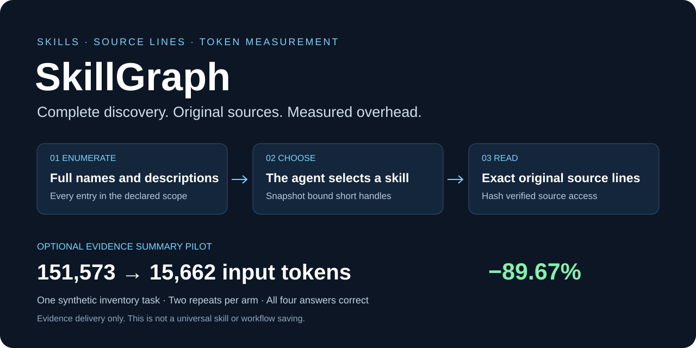
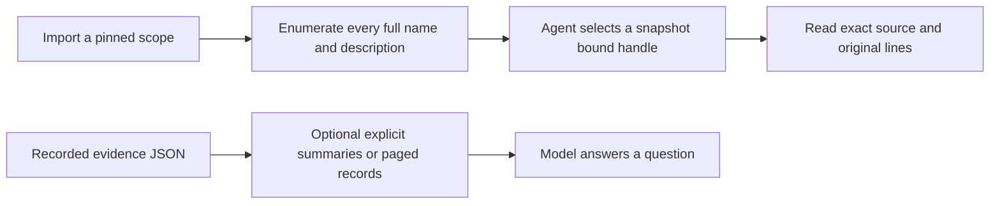

<p align="center"></p>

<p align="center"><a href="#quick-start">Quick start</a> · <a href="#measured-results">Results</a> · <a href="docs/model-usage-study.md">Real model experiment</a> · <a href="docs/catalog-study.md">Detailed comparisons</a> · <a href=".agents/skills/skillgraph/SKILL.md">Skill instructions</a></p>

# SkillGraph

**Complete agent skill discovery, exact original source lines, and reproducible token measurements.**

Keep every skill name and full description visible within a declared scope. Let the agent choose a skill, then read its original instructions with source hashes and line coordinates. Compact transport reduces repeated identifiers; optional evidence views compute explicit summaries before data reaches the model.

Experimental project · Node.js 24+ · CLI first · Optional inspection viewer

## Measured results

| Experiment | Baseline tokens | SkillGraph tokens | Reduction | Scope |
| --- | ---: | ---: | ---: | --- |
| **Actual model input** | 151,573 per call | 15,662 per call | **89.67%** | One synthetic inventory task; two repeats per arm |
| Complete catalog serialization | 6,034,240 | 3,135,249 | **48.04%** | Offline payload; full discovery text retained |
| Matched fresh skill access | 9,922 | 9,427 | **4.99%** | Three-task replay; response payload only |
| Matched grouped skill access | 5,122 | 5,033 | **1.74%** | Both arms reuse one full catalog |
| Real recorded REA evidence | 647,269 | 111,424 | **82.79%** | Offline; eight query groups per archive |

**The units and baselines differ. Do not pool these percentages.** The 89.67% model result comes from a deterministic evidence summary. It is not a universal reduction for skills or whole agent workflows.

All four model answers matched an independent Python ZIP oracle. That is **one task repeated**, not four independent tasks. Input plus output fell by **89.58%**. No retries or tool calls occurred; cached input was zero. Requested model: `gpt-6-astra`, reasoning `ultra`; the CLI did not report a resolved backend identifier.

[Method and limitations](docs/model-usage-study.md) · [Every model run](docs/model-usage-results.json) · [Offline evidence study](docs/evidence-study.md)

## How it works



| Capability | Behavior |
| --- | --- |
| Complete discovery | Every occurrence in the declared scope; no hidden relevance top-k list |
| Source preservation | Original bytes, line endings, SHA256 and original line coordinates |
| Compact transport | Factor repeated identifiers without shortening names or descriptions |
| Consistent snapshots | Bind handles to a catalog digest and reject stale reads |
| Visible limitations | Keep malformed entries, diagnostics and acquisition gaps explicit |
| Optional evidence views | Requested aggregates or records with coverage, warnings and source pointers |

The full catalog must still fit available context for complete model review. Pagination does not make a multi-million-token catalog fit in one context. Report that limit instead of silently narrowing the scope.

## Quick start

Requires **Node.js 24 or newer** and network access for imports. Imported skill scripts are not executed by the importer.

```powershell
git clone https://github.com/pluem4898/skillgraph.git
cd skillgraph
npm ci --ignore-scripts
node scripts/validate.ts

# A small pinned example scope
node scripts/import-github.ts --repos anthropics/skills --ref dbd4588f9e1033efb41dad4bef2f7947c8993d44
node scripts/smoke-cli.ts --repository anthropics/skills
node src/cli.ts catalog --repository anthropics/skills --wire packed --maxTokens 8000
```

Open the checkout as your Codex project and invoke `$skillgraph`. The [project-local skill](.agents/skills/skillgraph/SKILL.md) is included; it is not installed globally.

Follow every `nextOffset` using the same scope and `catalogHash` before final selection. Replace these placeholders with CLI values:

```powershell
node src/cli.ts catalog --repository anthropics/skills --offset NEXT --catalogHash DIGEST --wire packed --maxTokens 8000
node src/cli.ts open --repository anthropics/skills --handle HANDLE --catalogHash DIGEST --wire lean
node src/cli.ts read --file FILE_ID --start 10 --end 50 --hash CONTENT_HASH --numbered
```

`open` defaults to the complete selected source. Line ranges refer to the original file. For related tasks, enumerate once and use `open-many --handles s1,s2,s3 --catalogHash DIGEST --wire lean`. Reuse is valid only while the full catalog remains in active context. [Read the transport details](docs/catalog-study.md#lean-reads-and-retained-catalogs).

## Optional evidence summaries

This separate path consumes recorded REA inventories. It does not execute an input executable or perform new reverse engineering.

```powershell
node src/cli.ts evidence --input YOUR_RECORDED_REA.json --view summary
node src/cli.ts evidence --input YOUR_RECORDED_REA.json --view extensions
node src/cli.ts evidence --input YOUR_RECORDED_REA.json --view files --extension .gd --offset 0 --limit 100
node src/cli.ts evidence --input YOUR_RECORDED_REA.json --view record --index SOURCE_INDEX
```

Views are explicit projections with retained originals, not lossless compression of every raw field. Follow every file page when complete coverage is required. Cache hits reduce repeated computation; an identical response still contains the same tokens.

## Verify and reproduce

```powershell
node scripts/validate.ts
node --test tests/*.test.ts
node node_modules/typescript/bin/tsc --noEmit
```

The latest local Windows check passed **36 software tests** and TypeScript checking. GitHub Actions was blocked by an account billing lock; remote Windows/Linux CI success is not claimed.

| Resource | What you can inspect |
| --- | --- |
| [Actual model pilot](docs/model-usage-study.md) | Protocol, usage, correctness and reproduction |
| [Per-run results](docs/model-usage-results.json) | All four answers and every reported usage field |
| [Evidence study](docs/evidence-study.md) | Independent oracle, runtime costs and representation disagreements |
| [Evidence measurements](docs/evidence-results.json) | Aggregates and provenance digests |
| [Catalog study](docs/catalog-study.md) | Detailed corpus comparisons, negative results and context limits |
| [Launch kit](docs/launch-kit.md) | Accurate share text and a practical outreach plan |

The catalog study covers **40,545 occurrences**, with **40,541 readable targets**, in a declared bounded corpus. It is not an index of all GitHub. Supporting-file gaps and acquisition details remain documented.

## Try it and share your results

Start with the small pinned import. For a fair comparison, use the same task, corpus and model settings in both arms. Count every call, retry and required reference; keep answer failures in the results. [Report a reproducible issue](https://github.com/pluem4898/skillgraph/issues/new/choose), including cases where overhead outweighs savings.

If this helps your work, share [the repository](https://github.com/pluem4898/skillgraph) with people building agent skill libraries or studying context costs. Independent reproductions and counterexamples are welcome.

## Project layout

```text
.agents/skills/skillgraph/  Project-local skill and evidence reference
src/                       Store, parser, transport, CLI and optional viewer
scripts/                   Importers, audits and experiments
tests/                     Integrity, paging, transport and HTTP checks
config/                    Corpus settings and revision lock
docs/                      Public measurements and guides
data/ reports/ research/   Local artifacts excluded from Git
```

The optional viewer runs with `node src/server.ts` at `http://127.0.0.1:4318`. Using the skill requires no web server.

The English Word report and manuscript stay local. Downloaded skills, private executable evidence, credentials, databases and raw research logs are excluded from Git. Source packages retain their own licenses.
